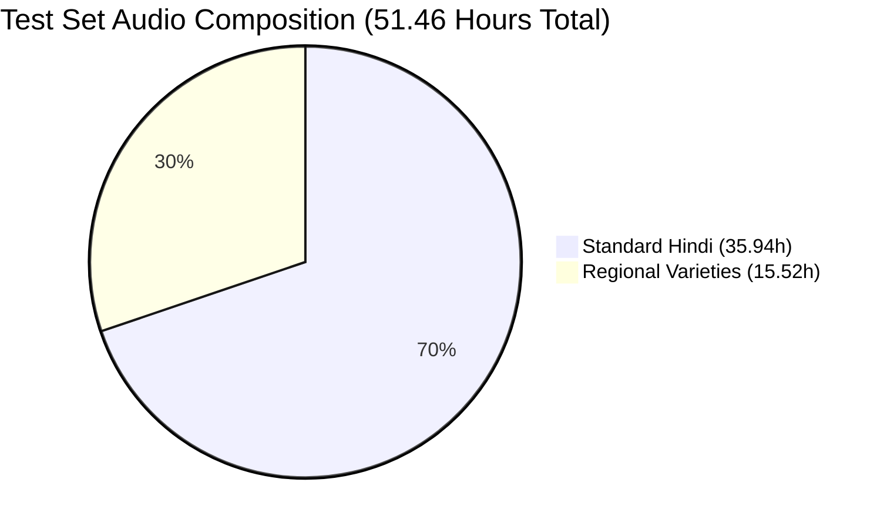
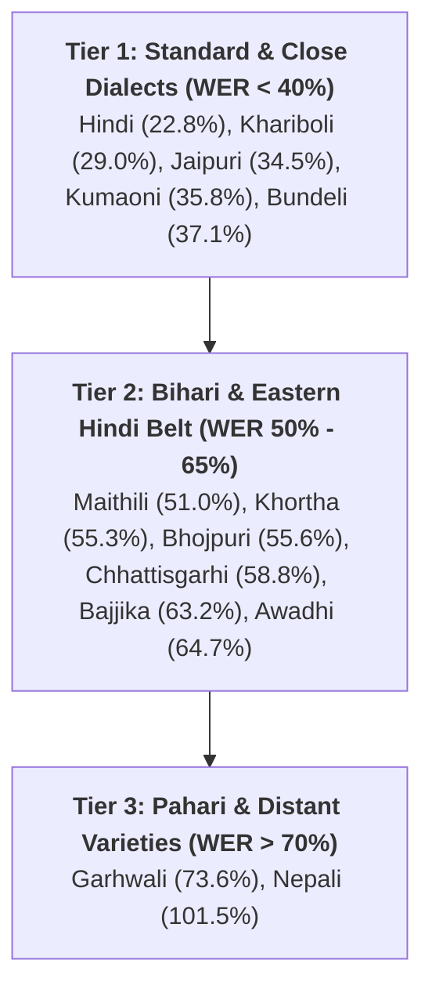

# STIPA Project: Baseline ASR Evaluation Report
**Model:** `ai4bharat/indicconformer_stt_hi_hybrid_ctc_rnnt_large`  
**Architecture:** Conformer-Large Encoder + Hybrid RNNT-CTC Decoder (RNNT evaluated)  
**Evaluation Date:** October 15, 2026  
**Hardware Platform:** GCP Cluster `another-t4-cluster` (NVIDIA Tesla T4 GPU 2)  
**Test Set Manifest:** `final_test.jsonl` (Shelly's Official Test Set)  

---

## 1. Executive Summary

We conducted the full, pure baseline Automatic Speech Recognition (ASR) benchmark using AI4Bharat's official off-the-shelf Hindi IndicConformer model. The evaluation processed **33,244 utterances (51.46 hours)** across standard Hindi and 16 regional Hindi-belt varieties and sister languages.

### Core Benchmark Metrics
* **Total Dataset Volume:** **33,244 utterances (51.46 hours)**
* **Overall Test Set WER:** **33.01%**
* **Overall Test Set CER:** **15.40%**
* **Standard Hindi Performance:** **22.76% WER | 10.46% CER** (35.94 hours, 23,692 utterances)
* **Regional Varieties / Dialects:** **59.66% WER | 27.69% CER** (15.52 hours, 9,552 utterances)
* **Inference Throughput:** **~1.34 batches/sec (~43 utterances/sec)** on Tesla T4; entire 51.46 hours evaluated in **under 20 minutes** (speedup: **~155x Real-Time**).

---

## 2. Complete Results by Language Variety

All metrics below reflect standard Indic text normalization (removal of Devanagari dandas `।`, `॥`, standard Latin/Indic punctuation, and collapsed whitespace).

| Rank | Language Variety | Utterances | Hours | % of Set | WER (%) | CER (%) | Error Multiplier vs Hindi |
| :---: | :--- | :---: | :---: | :---: | :---: | :---: | :---: |
| 1 | **Hindi** | 23,692 | 35.94h | 69.84% | **22.76%** | **10.46%** | **1.0x** *(Baseline)* |
| 2 | **Khariboli** | 358 | 0.68h | 1.32% | **29.02%** | **12.94%** | **1.28x** |
| 3 | **Jaipuri** | 40 | 0.09h | 0.17% | **34.52%** | **17.37%** | **1.52x** |
| 4 | **Kumaoni** | 576 | 1.27h | 2.47% | **35.79%** | **16.82%** | **1.57x** |
| 5 | **Bundeli** | 222 | 0.41h | 0.79% | **37.08%** | **17.53%** | **1.63x** |
| 6 | **Maithili** | 725 | 1.35h | 2.62% | **50.99%** | **26.04%** | **2.24x** |
| 7 | **Khortha** | 1,316 | 1.84h | 3.58% | **55.28%** | **26.90%** | **2.43x** |
| 8 | **Bhojpuri** | 938 | 1.59h | 3.09% | **55.59%** | **24.66%** | **2.44x** |
| 9 | **Thethi** | 51 | 0.07h | 0.13% | **56.13%** | **25.66%** | **2.47x** |
| 10 | **Haryanvi** | 80 | 0.12h | 0.23% | **57.77%** | **26.24%** | **2.54x** |
| 11 | **Surgujia** | 262 | 0.31h | 0.61% | **58.59%** | **27.72%** | **2.57x** |
| 12 | **Chhattisgarhi** | 791 | 1.18h | 2.29% | **58.84%** | **26.82%** | **2.58x** |
| 13 | **Rajasthani** | 541 | 0.82h | 1.59% | **60.11%** | **34.71%** | **2.64x** |
| 14 | **Bajjika** | 1,156 | 2.51h | 4.88% | **63.16%** | **27.98%** | **2.77x** |
| 15 | **Awadhi** | 91 | 0.13h | 0.26% | **64.68%** | **31.00%** | **2.84x** |
| 16 | **Garhwali** | 392 | 0.58h | 1.13% | **73.59%** | **38.33%** | **3.23x** |
| 17 | **Nepali** | 2,013 | 2.57h | 5.00% | **101.55%** | **39.60%** | **4.46x** |
| — | **OVERALL CORPUS** | **33,244** | **51.46h** | **100.0%** | **33.01%** | **15.40%** | **1.45x** |

---

## 3. Key Scientific Findings & Analysis

### Finding A: The Dialect Degradation Gradient
The empirical results reveal a distinct 3-tier performance hierarchy:

1. **Standard & Close Dialects (WER < 40%):**  
   Khariboli (29.02%), Jaipuri (34.52%), and Bundeli (37.08%) demonstrate moderate lexical and acoustic proximity to formal Hindi.
2. **The Core Regional Belt (WER 50% – 65%):**  
   Bhojpuri, Maithili, Khortha, Chhattisgarhi, and Bajjika see a **2.2x to 2.8x increase in error rate** over standard Hindi. The off-the-shelf Hindi language model forces standard Hindi vocabulary onto regional morphological suffixes (e.g. Bhojpuri `-ba`, `-la`, `-ani`).
3. **Pahari & Divergent Languages (WER > 70%):**  
   Garhwali (73.59%) and Nepali (101.55%) experience extreme degradation. Nepali has a distinct grammatical syntax and post-positional markers that cause complete insertion/deletion cascades in the RNNT decoder.

> [!IMPORTANT]
> **Why this validates the STIPA project:**  
> The 22.76% $\rightarrow$ 59.66% gap provides undeniable statistical proof that standard Hindi ASR models fail severely on regional varieties. This sets the exact baseline target for our fine-tuning phase.

---

## 4. Deliverables & Data Artifacts

After a full test run with `--output_dir ./stipa_full_eval`, outputs are written relative to that directory:

1. **Summary table CSV:** `./stipa_full_eval/baseline_summary_by_language.csv`
2. **Detailed predictions (33,244 rows):** `./stipa_full_eval/baseline_predictions_detailed.csv`  
   Includes `audio_filepath`, `duration`, `language`, `gender`, `text` (reference), `pred_norm` (model prediction), `sample_wer`, and `sample_cer`.
3. **Evaluation script:** `./run_baseline_eval.py` (see `README.md` for setup and commands).

Reference CSVs from the original October 2026 run may also be shared out-of-band (shared drive or email) for comparison without re-running ~51 hours of inference.
